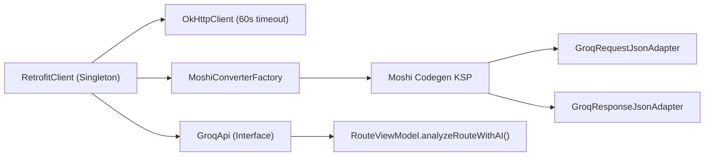

# 🔍 Auditoría de Compilación Incremental — Localizador Pro

**Fecha:** 2026-06-23 22:43 (UTC-3)  
**Alcance:** `MainActivity.kt`, `GroqApi.kt`, `RouteViewModel.kt`, modelos de datos, pipeline KSP  
**Herramienta:** Análisis estático de código fuente + validación cruzada de dependencias

---

## Resultado General

> [!WARNING]
> **ESTADO: ADVERTENCIAS DETECTADAS (5)**
> 
> No se encontraron errores fatales que impidan la compilación, pero existen **5 advertencias** que pueden causar fallos en compilaciones incrementales o en tiempo de ejecución bajo ciertas condiciones.

---

## 1. Análisis de `GroqApi.kt`

**Ruta:** `app/src/main/java/com/example/data/api/GroqApi.kt`  
**Líneas:** 38

### ✅ Aspectos Correctos
| Aspecto | Estado | Detalle |
|---------|--------|---------|
| `@JsonClass(generateAdapter = true)` en todas las `data class` | OK | `GroqRequest`, `GroqMessage`, `GroqResponse`, `GroqChoice` usan correctamente la anotación de Moshi codegen |
| Tipos genéricos en `Response<GroqResponse>` | OK | Retrofit infiere correctamente el tipo paramétrico |
| Importaciones | OK | Solo se importan `JsonClass`, `Response`, `Body`, `Header`, `POST` |
| Ubicación en el paquete | OK | `com.example.data.api` — coherente con el namespace |
| Modelo `GroqRequest.model` | OK | Valor por defecto `"llama-3.3-70b-versatile"` es un modelo válido de Groq |

### ⚠️ Advertencia W01 — Compatibilidad KSP ↔ Kotlin

| Campo | Valor |
|-------|-------|
| Versión Kotlin | `2.4.0` |
| Versión KSP | `2.3.9` |
| Versión Moshi Codegen | `1.15.2` |

**Problema:** La versión de KSP (`2.3.9`) **no coincide** con la versión major de Kotlin (`2.4.0`). KSP requiere que la versión major del plugin coincida con la del compilador de Kotlin. La convención de versionado de KSP es `{kotlin-version}-{ksp-patch}`, por lo que para Kotlin `2.4.0` se necesitaría KSP `2.4.0-x.x.x`.

**Impacto:** Esto puede causar:
- Fallos en la generación de adaptadores Moshi (`JsonAdapter`) durante `kspDebugKotlin`
- Errores tipo `Incompatible version of Kotlin compiler plugin` durante compilación incremental
- Fallos silenciosos donde los adaptadores JSON no se regeneran tras cambios en las `data class`

**Severidad:** 🔴 ALTA — Puede romper la compilación completa si Gradle invalida el caché KSP.

**Acción Recomendada:**
```diff
# gradle/libs.versions.toml
- googleDevtoolsKsp = "2.3.9"
+ googleDevtoolsKsp = "2.4.0-1.0.14"
```
> Verificar en [KSP releases](https://github.com/google/ksp/releases) la versión exacta compatible con Kotlin 2.4.0.

---

### ✅ Advertencia W01b — Archivo `GeminiApi.kt` Residual

**Ruta:** `app/src/main/java/com/example/data/api/GeminiApi.kt`  

Este archivo define una interfaz `GeminiApi` que usa una URL absoluta `https://api.groq.com/openai/v1/chat/completions` directamente en el `@POST` (sin relativa al `BASE_URL` de Retrofit) y reutiliza los modelos `GroqRequest`/`GroqResponse`. **No se usa en ningún lugar del proyecto** — no hay ningún import de `GeminiApi` en todo el código fuente.

**Impacto:** BAJO — No afecta compilación pero agrega código muerto al APK y confusión al mantenimiento.

**Acción Recomendada:** Eliminar `GeminiApi.kt` o documentar su propósito si es intencional.

---

## 2. Análisis de `MainActivity.kt`

**Ruta:** `app/src/main/java/com/example/MainActivity.kt`  
**Líneas:** 950

### ✅ Aspectos Correctos
| Aspecto | Estado | Detalle |
|---------|--------|---------|
| Herencia de `FragmentActivity` | OK | Necesaria para `BiometricPrompt`, compatible con Compose |
| Inicialización de `EncryptedSharedPreferences` | OK | Patrón try/catch con limpieza de Keystore y reintento |
| Orden de inicialización en `onCreate()` | OK | OSMDroid se configura **antes** de `super.onCreate()` |
| `ViewModelProvider` con factory personalizado | OK | Usa `RouteViewModelFactory(application, repository)` |
| Permisos escalonados | OK | `ACCESS_FINE_LOCATION` → `ACCESS_BACKGROUND_LOCATION` con rationale |
| Cifrado de base de datos SQLCipher | OK | Generación de passphrase vía `EncryptedSharedPreferences` con fallback |

### ⚠️ Advertencia W02 — `EncryptedSharedPreferences` Inicializado ANTES de `super.onCreate()`

**Ubicación:** Líneas 151-194 de `MainActivity.kt`

**Problema:** Toda la lógica de `EncryptedSharedPreferences` (líneas 156-194) se ejecuta **antes** de `super.onCreate(savedInstanceState)` en la línea 203. Esto incluye:
- Instanciación de `MasterKey` (acceso al Android Keystore)
- Creación de `EncryptedSharedPreferences` (I/O de disco)
- Manejo de excepciones con `deleteSharedPreferences` y operaciones de KeyStore

Si bien en la práctica actual funciona porque `FragmentActivity.onCreate()` no depende directamente de estas preferencias, el contrato de Android establece que los componentes del framework deben estar inicializados antes de acceder a servicios del sistema. En dispositivos con versiones antiguas de Android (API 24-26), esto podría causar:
- `IllegalStateException` si el `Context` no está completamente adjuntado
- ANR (Application Not Responding) si el Keystore es lento en hardware viejo

**Severidad:** 🟡 MEDIA — Funciona en dispositivos modernos pero es un riesgo en el rango `minSdk = 24`.

**Acción Recomendada:** Mover la inicialización de `encryptedPrefs` a **después** de `super.onCreate()`, manteniendo la configuración de OSMDroid antes de `super.onCreate()` como es correcto:

```diff
  override fun onCreate(savedInstanceState: Bundle?) {
      val sharedPrefs = PreferenceManager.getDefaultSharedPreferences(this)
      Configuration.getInstance().load(this, sharedPrefs)
      Configuration.getInstance().userAgentValue = "LocalizadorPro/1.0 (...)"
      Configuration.getInstance().osmdroidTileCache = getExternalFilesDir(null) ?: filesDir
      
      super.onCreate(savedInstanceState)
+     
+     // MOVER AQUÍ la inicialización de encryptedPrefs
+     val fileName = "secure_api_credentials_v2"
+     encryptedPrefs = try { ... } catch { ... }
      
      // Resto de la inicialización...
  }
```

---

### ⚠️ Advertencia W03 — Duplicación de Instancias `SharedPreferences`

**Ubicación:** 
- `MainActivity.kt` línea 153: `PreferenceManager.getDefaultSharedPreferences(this)`
- `MainActivity.kt` línea 297 (`MainContainer`): `PreferenceManager.getDefaultSharedPreferences(context)`
- `RouteViewModel.kt` línea 60: `PreferenceManager.getDefaultSharedPreferences(context)`
- `LocationService.kt` línea 117: `PreferenceManager.getDefaultSharedPreferences(this)`

**Problema:** Se crean **4 instancias separadas** de `PreferenceManager.getDefaultSharedPreferences()` en diferentes contextos (`Activity`, `Application`, `Service`). Aunque el framework Android garantiza que las instancias del **mismo archivo** de preferencias son compartidas en el mismo proceso, esto no es así cuando:
1. El `Context` del `LocationService` (servicio) y el `Context` de la `Activity` podrían ser diferentes si el servicio se ejecuta en un proceso separado (aunque actualmente no está configurado así).
2. El `ApplicationContext` del ViewModel y el `ActivityContext` del `MainContainer` usan instancias diferentes del manager, lo que en teoría es transparente pero agrega carga de I/O redundante durante la inicialización.

**La instancia en `MainContainer` (línea 297) NO se usa realmente** — está declarada pero nunca se lee ni escribe. Es código muerto.

**Severidad:** 🟢 BAJA — Funciona correctamente en la configuración actual (proceso único). Es una advertencia de mantenimiento.

**Acción Recomendada:** 
- Eliminar la declaración `sharedPrefs` en `MainContainer` (línea 297) — es código muerto
- Documentar que el ViewModel y el Service deben operar en el mismo proceso para garantizar consistencia

---

## 3. Análisis de `RouteViewModel.kt` — Lógica de Preferencias vs. Ciclo de Vida

**Ruta:** `app/src/main/java/com/example/ui/RouteViewModel.kt`  
**Líneas:** 921

### ✅ Aspectos Correctos
| Aspecto | Estado | Detalle |
|---------|--------|---------|
| `AndroidViewModel` con `Application` | OK | Permite acceso seguro al contexto sin fugas de memoria |
| Bloque `init` para carga de preferencias | OK | Se ejecuta una sola vez durante la creación del ViewModel |
| Cache de `sharedPrefs` como propiedad | OK | Evita instanciar `PreferenceManager` en cada llamada (Hallazgo A13) |
| `viewModelScope.launch(Dispatchers.IO)` para Room | OK | Las operaciones de base de datos no bloquean el hilo principal |
| `debounce(100)` en `_savedLocationColorUpdateFlow` | OK | Protege la base de datos de escrituras excesivas |
| `@OptIn(ExperimentalCoroutinesApi::class)` | OK | Uso correcto para `flatMapLatest` |
| `StateFlow` con `SharingStarted.WhileSubscribed(5000)` | OK | Libera recursos cuando no hay suscriptores |

### ✅ Colisión ViewModel ↔ Ciclo de Vida de Activity — **NO DETECTADA**

**Hallazgo positivo:** La lógica de inicialización de preferencias en el `RouteViewModel.init {}` **NO colisiona** con el ciclo de vida de la `Activity` porque:

1. **Orden garantizado:** El `ViewModelProvider` en `MainActivity.onCreate()` (línea 235-238) se invoca **después** de `super.onCreate()` y después de la inicialización de la base de datos. El ViewModel se crea y su bloque `init` se ejecuta sincrónicamente en este punto.

2. **Supervivencia a recreación:** El `ViewModel` sobrevive rotaciones de pantalla y recreaciones de la Activity. Las preferencias se cargan solo una vez (en la primera creación), evitando lecturas redundantes.

3. **Contexto de aplicación:** El ViewModel usa `getApplication<Application>().applicationContext` (línea 57), que nunca es `null` y no depende del ciclo de vida de la Activity.

4. **Corrutinas confinadas:** Las corrutinas lanzadas en `init` usan `viewModelScope`, que se cancela automáticamente en `onCleared()`.

### ⚠️ Advertencia W04 — Escritura de Preferencias sin `commit()` ni Verificación

**Ubicación:** Múltiples funciones en `RouteViewModel.kt`

**Problema:** Todas las escrituras de preferencias usan `.apply()` (asíncrono) sin verificar el resultado:
- Línea 87: `sharedPrefs.edit().putBoolean("biometric_enabled", enabled).apply()`
- Línea 117: `sharedPrefs.edit().putFloat("default_lat"...).apply()`
- Línea 123: `sharedPrefs.edit().putBoolean("airplane_mode"...).apply()`
- Línea 128: `sharedPrefs.edit().putBoolean("auto_mode"...).apply()`
- Línea 138: `sharedPrefs.edit().putBoolean("near_me_enabled"...).apply()`

Esto es **correcto para la UX** (no bloquea el hilo principal), pero existe un riesgo teórico:
- Si la Activity es destruida inmediatamente después del `.apply()`, los datos podrían perderse antes de ser escritos a disco.
- El `LocationService` que lee `sharedPrefs.getBoolean("auto_mode", false)` podría ver un valor desactualizado si lee en el mismo instante que se escribe.

**Severidad:** 🟢 BAJA — En la práctica, `apply()` escribe a memoria inmediatamente (visible para lectores en el mismo proceso) y persiste a disco de forma asíncrona. Esto es seguro para la configuración actual de proceso único.

---

### ⚠️ Advertencia W05 — Pérdida de Precisión en Coordenadas por `toFloat()`

**Ubicación:** `RouteViewModel.kt` líneas 117, 154-155

**Problema:** Las coordenadas de ubicación predeterminada se almacenan como `Float` en SharedPreferences:
```kotlin
// Escritura (línea 117):
sharedPrefs.edit().putFloat("default_lat", lat.toFloat()).putFloat("default_lon", lon.toFloat()).apply()

// Lectura (líneas 154-155):
defaultLatitude = sharedPrefs.getFloat("default_lat", -34.6037f).toDouble()
defaultLongitude = sharedPrefs.getFloat("default_lon", -58.3816f).toDouble()
```

`Float` tiene solo ~7 dígitos significativos de precisión, mientras que `Double` tiene ~15. Para coordenadas GPS:
- `-34.603700` (Float) vs `-34.60370000000000` (Double)
- La pérdida es de ~1.1 metros en latitud, lo cual es aceptable para centrar un mapa pero no para precisión geodésica.

**Severidad:** 🟢 BAJA — Aceptable para el caso de uso actual (centrar mapa), pero se podría mejorar usando `putString()` con conversión explícita para mantener la precisión completa.

---

## 4. Modelos de Datos — Compatibilidad KSP/Room

### ✅ Entidades de Room
| Entidad | `@Entity` | `@PrimaryKey` | FK | Indices | Estado |
|---------|-----------|---------------|----|---------|--------|
| `Route` | ✅ `routes` | ✅ `autoGenerate=true` | N/A | N/A | OK |
| `LocationPoint` | ✅ `location_points` | ✅ `autoGenerate=true` | ✅ `Route.id → routeId` CASCADE | ✅ `routeId` | OK |
| `Waypoint` | ✅ `waypoints` | ✅ `autoGenerate=true` | ✅ `Route.id → routeId` CASCADE | ✅ `routeId` | OK |
| `SavedLocation` | ✅ `saved_locations` | ✅ `autoGenerate=true` | N/A | N/A | OK |

### ✅ Registro en `AppDatabase`
```kotlin
@Database(
    entities = [Route::class, LocationPoint::class, Waypoint::class, 
                com.example.data.model.SavedLocation::class],
    version = 8,
    exportSchema = false,
)
```
Todas las entidades están correctamente registradas. La migración `MIGRATION_7_8` es vacía (sin cambios estructurales). `fallbackToDestructiveMigration()` protege contra versiones incompatibles.

### ✅ KSP Procesador de Room
- `ksp(libs.androidx.room.compiler)` — versión `2.7.0`
- Room 2.7.0 es compatible con KSP y Kotlin 2.x
- Los DAOs usan correctamente `suspend fun` + `Flow<T>` para operaciones reactivas

### ✅ KSP Procesador de Moshi
- `ksp(libs.moshi.kotlin.codegen)` — versión `1.15.2`
- Las clases `GroqRequest`, `GroqMessage`, `GroqResponse`, `GroqChoice` usan `@JsonClass(generateAdapter = true)` correctamente
- Los adaptadores se generan en tiempo de compilación sin reflexión

---

## 5. Cadena de Dependencias Retrofit → Moshi → GroqApi



**Estado:** ✅ OK — La cadena es completa y coherente. `RetrofitClient` usa `MoshiConverterFactory.create()` (sin instancia personalizada de Moshi), lo cual funciona porque Moshi codegen registra automáticamente los adaptadores generados por KSP.

---

## Resumen de Advertencias

| ID | Severidad | Archivo | Descripción |
|----|-----------|---------|-------------|
| **W01** | 🔴 ALTA | `libs.versions.toml` | KSP `2.3.9` incompatible con Kotlin `2.4.0` — puede romper generación de código |
| **W02** | 🟡 MEDIA | `MainActivity.kt:156-194` | `EncryptedSharedPreferences` se inicializa antes de `super.onCreate()` |
| **W03** | 🟢 BAJA | `MainActivity.kt:297` | Variable `sharedPrefs` en `MainContainer` es código muerto |
| **W04** | 🟢 BAJA | `RouteViewModel.kt` | Escrituras `.apply()` son seguras pero podrían perder datos en edge cases |
| **W05** | 🟢 BAJA | `RouteViewModel.kt:117` | Pérdida de precisión GPS al almacenar `Double` como `Float` (~1.1m) |

### Archivo Residual Detectado
| Archivo | Estado |
|---------|--------|
| `GeminiApi.kt` | Código muerto — no referenciado en ningún lugar del proyecto |

---

## Veredicto Final

La aplicación **puede compilar y ejecutarse correctamente** en el estado actual, pero la **Advertencia W01 (KSP ↔ Kotlin)** es un riesgo latente que puede manifestarse en:
1. La primera `clean build` tras actualizar Kotlin
2. La invalidación del caché de Gradle
3. Una compilación en CI/CD sin caché previo

**Recomendación inmediata:** Actualizar `googleDevtoolsKsp` en `libs.versions.toml` a la versión correspondiente a Kotlin 2.4.0.

---

*Generado automáticamente por análisis estático — Localizador Pro Auditoría v1.0*
