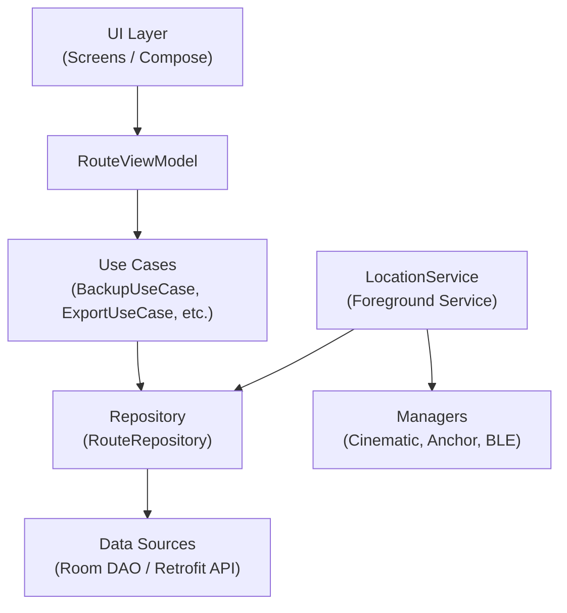
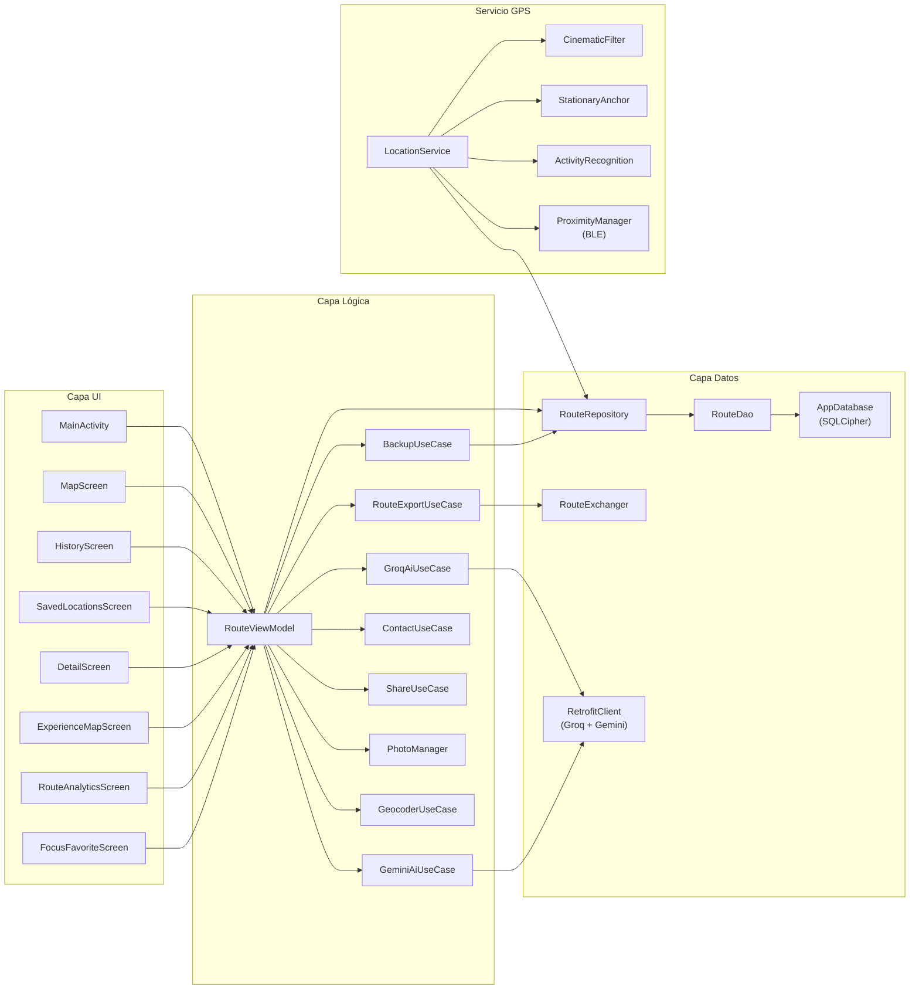

# 📋 Informe Completo de Revisión — Proyecto Localizador
## Fase Alfa · 15 de julio de 2026

---

## 1. Resumen Ejecutivo

**Localizador** es una aplicación Android nativa de rastreo GPS desarrollada con **Kotlin + Jetpack Compose + Room** (SQLCipher). El proyecto se encuentra en **fase alfa** y presenta una base técnica sólida con funcionalidades avanzadas que incluyen:

- Rastreo GPS en segundo plano con servicio Foreground
- Mapas offline con osmdroid
- Análisis de rutas con IA (Groq / Gemini)
- Proximidad BLE entre contactos
- Backup/Restore completo con multimedia
- Seguridad biométrica + cifrado de base de datos

| Dato | Valor |
|------|-------|
| **Namespace** | `com.example` |
| **Application ID** | `com.aistudio.localizador.vqtspk` |
| **SDK Mínimo** | 24 (Android 7.0) |
| **SDK Objetivo** | 35 (Android 15) |
| **Versión Actual** | 2.0 (versionCode: 2) |
| **JDK** | 17 |
| **Base de Datos** | Room + SQLCipher (versión 12) |
| **Mapa** | osmdroid (OpenStreetMap) |

---

## 2. Arquitectura del Proyecto

### 2.1 Estructura de Paquetes

```
com.example/
├── MainActivity.kt                    (1044 líneas ⚠️)
├── data/
│   ├── api/                           # Clientes Retrofit (Groq, Gemini)
│   │   ├── GeminiApi.kt
│   │   ├── GroqApi.kt
│   │   └── RetrofitClient.kt
│   ├── db/                            # Room Database + DAO
│   │   ├── AppDatabase.kt
│   │   └── RouteDao.kt
│   ├── export/                        # Motor de intercambio de rutas
│   │   └── RouteExchanger.kt
│   ├── model/                         # Entidades Room
│   │   ├── LocationPoint.kt
│   │   ├── Route.kt
│   │   ├── RouteFavoriteCrossRef.kt
│   │   ├── SavedLocation.kt
│   │   └── Waypoint.kt
│   └── repository/
│       └── RouteRepository.kt
├── domain/
│   └── usecase/                       # (Vacío)
├── location/
│   ├── LocationService.kt            (1161 líneas ⚠️)
│   ├── ProximityManager.kt
│   ├── manager/
│   │   ├── ActivityRecognitionManager.kt
│   │   ├── CinematicFilterManager.kt
│   │   └── StationaryAnchorManager.kt
│   └── receiver/
│       └── ActivityTransitionReceiver.kt
├── ui/
│   ├── RouteViewModel.kt             (566 líneas)
│   ├── RouteViewModelFactory.kt
│   ├── BackupUseCase.kt
│   ├── ContactUseCase.kt
│   ├── GeminiAiUseCase.kt
│   ├── GeocoderUseCase.kt
│   ├── GroqAiUseCase.kt
│   ├── LocationParser.kt
│   ├── LocationServiceManager.kt
│   ├── PhotoManager.kt
│   ├── PreferencesManager.kt
│   ├── RouteExportUseCase.kt
│   ├── RouteSegmenter.kt
│   ├── ShareUseCase.kt
│   ├── components/
│   │   ├── BrandWatermark.kt
│   │   ├── FullScreenPhotoDialog.kt
│   │   ├── TopBarLocalizador.kt
│   │   └── TourOverlay.kt
│   ├── dialogs/
│   │   ├── ApiKeyDialog.kt
│   │   ├── DeleteAllConfirmDialog.kt
│   │   ├── DeleteConfirmationDialog.kt
│   │   ├── HelpDialog.kt
│   │   └── LocationDialog.kt
│   ├── model/
│   │   └── IconCategory.kt
│   ├── navigation/
│   │   └── NavRoutes.kt
│   ├── screens/
│   │   ├── DetailScreen.kt
│   │   ├── DynamicHistoryBottomBar.kt
│   │   ├── ExperienceMapScreen.kt
│   │   ├── FocusFavoriteScreen.kt
│   │   ├── HistoryScreen.kt
│   │   ├── MapScreen.kt             (1117 líneas ⚠️)
│   │   ├── RouteAnalyticsScreen.kt
│   │   ├── SavedLocationsScreen.kt  (45KB ⚠️)
│   │   └── WaypointsHorizontalSelector.kt
│   ├── theme/
│   │   ├── Color.kt
│   │   ├── Theme.kt
│   │   └── Type.kt
│   └── util/                          # (Vacío)
└── util/
    ├── AlertNotifier.kt
    ├── AppConstants.kt
    ├── BiometricCipherHelper.kt
    ├── BleContactMapper.kt
    └── ContactHashHelper.kt
```

### 2.2 Patrón Arquitectónico

El proyecto sigue un patrón **MVVM** (Model-View-ViewModel) con separación en capas:



> [!NOTE]
> La inyección de dependencias es manual a través de `RouteViewModelFactory`, no se utiliza Hilt/Dagger. Esto es aceptable para el tamaño actual del proyecto pero puede complicarse a medida que crezca.

---

## 3. Análisis Detallado por Módulo

### 3.1 Capa de Datos (`data/`)

#### Base de Datos — [AppDatabase.kt](file:///d:/Google%20IA%20Studio/localizador/app/src/main/java/com/example/data/db/AppDatabase.kt)

| Aspecto | Evaluación |
|---------|------------|
| Cifrado SQLCipher | ✅ Implementado correctamente |
| Migraciones | ✅ 5 migraciones definidas (7→12) |
| Singleton thread-safe | ✅ Con `@Volatile` + `synchronized` |
| `exportSchema = false` | ⚠️ Debería ser `true` para validar migraciones |
| `fallbackToDestructiveMigration` | ⚠️ Riesgo de pérdida de datos en producción |

**Observaciones críticas:**
- Las migraciones `MIGRATION_7_8` y `MIGRATION_9_10` están vacías (sin cuerpo). Esto sugiere que se saltaron versiones sin cambios reales, lo cual funciona pero genera confusión.
- `fallbackToDestructiveMigration(dropAllTables = true)` es peligroso para usuarios reales: si una migración falla, se borran todos los datos sin aviso.

#### Entidades Room

| Entidad | Tabla | Campos | Relaciones |
|---------|-------|--------|------------|
| [Route](file:///d:/Google%20IA%20Studio/localizador/app/src/main/java/com/example/data/model/Route.kt) | `routes` | 9 | — |
| [LocationPoint](file:///d:/Google%20IA%20Studio/localizador/app/src/main/java/com/example/data/model/LocationPoint.kt) | `location_points` | 7 | FK → Route (CASCADE) |
| [Waypoint](file:///d:/Google%20IA%20Studio/localizador/app/src/main/java/com/example/data/model/Waypoint.kt) | `waypoints` | 9 | FK → Route (CASCADE) |
| [SavedLocation](file:///d:/Google%20IA%20Studio/localizador/app/src/main/java/com/example/data/model/SavedLocation.kt) | `saved_locations` | 16 | Índice único (lat, lon) |
| [RouteFavoriteCrossRef](file:///d:/Google%20IA%20Studio/localizador/app/src/main/java/com/example/data/model/RouteFavoriteCrossRef.kt) | `route_favorite_cross_ref` | 2 | FK → Route + SavedLocation |

✅ Las relaciones foreign key con `CASCADE` están correctamente definidas.
✅ Los índices sobre claves foráneas están presentes para optimizar JOINs.

#### DAO — [RouteDao.kt](file:///d:/Google%20IA%20Studio/localizador/app/src/main/java/com/example/data/db/RouteDao.kt)

- **151 líneas** con operaciones bien tipadas.
- Soporta tanto consultas `Flow` (reactivas) como `suspend` (síncronas).
- Implementa limpieza de duplicados y relaciones huérfanas.
- ⚠️ Falta un método `deleteWaypointById()` individual.

#### Repositorio — [RouteRepository.kt](file:///d:/Google%20IA%20Studio/localizador/app/src/main/java/com/example/data/repository/RouteRepository.kt)

- **288 líneas**, bien documentado con KDoc en español.
- Usa `NonCancellable + Dispatchers.IO` para la persistencia final de ruta (robusto).
- Patrón Repository implementado correctamente desacoplando DAO del ViewModel.

---

### 3.2 Servicio de Localización (`location/`)

#### LocationService — [LocationService.kt](file:///d:/Google%20IA%20Studio/localizador/app/src/main/java/com/example/location/LocationService.kt)

> [!WARNING]
> **1161 líneas** — Este archivo es el más crítico y el más largo del proyecto. Necesita refactorización urgente.

**Funcionalidades implementadas:**

| Funcionalidad | Estado | Complejidad |
|---------------|--------|-------------|
| Foreground Service con notificación | ✅ | Baja |
| FusedLocationProvider | ✅ | Media |
| Filtrado cinemático (velocidad aberrante) | ✅ | Alta |
| Anclaje estacionario (interiores) | ✅ | Alta |
| Auto-start por velocidad sostenida | ✅ | Alta |
| Auto-stop por inactividad | ✅ | Alta |
| Buffer de pre-grabación (60s) | ✅ | Alta |
| Detección de modo actividad (inercia) | ✅ | Media |
| Marcador de paradas cortas | ✅ | Media |
| Alerta "Cerca de mí" (geofencing) | ✅ | Media |
| Proximidad BLE (contactos) | ✅ | Alta |
| Watchdog de señal GPS | ✅ | Media |
| WakeLock (25h timeout) | ✅ | Baja |
| Reconocimiento de actividad (Google API) | ✅ | Media |
| Modo avión (límites de velocidad) | ✅ | Baja |

**Fortalezas:**
- Filtrado en 2 capas: precisión cinemática → anclaje estacionario
- Odómetro dual: capa A tolerante (50m), capa B estricta (20m)
- Inicialización simétrica de cifrado SQLCipher en el servicio
- `HandlerThread` dedicado para procesamiento GPS fuera del Main Thread

**Debilidades:**
- Demasiadas responsabilidades en una sola clase
- Variables de estado mutable dispersas (`var` con tipos primitivos)
- Duplicación de lógica de notificaciones entre `sendProximityNotification` y `onBleContactDetected`
- `companion object` con estado mutable global (anti-patrón)

#### Managers de Localización

| Manager | Líneas | Función | Evaluación |
|---------|--------|---------|------------|
| [CinematicFilterManager](file:///d:/Google%20IA%20Studio/localizador/app/src/main/java/com/example/location/manager/CinematicFilterManager.kt) | 89 | Filtro de inercia y autostop | ✅ Bien aislado |
| [StationaryAnchorManager](file:///d:/Google%20IA%20Studio/localizador/app/src/main/java/com/example/location/manager/StationaryAnchorManager.kt) | 82 | Congelación de posición en interiores | ✅ Bien aislado |
| [ActivityRecognitionManager](file:///d:/Google%20IA%20Studio/localizador/app/src/main/java/com/example/location/manager/ActivityRecognitionManager.kt) | 81 | Auto-arranque por transiciones | ✅ Bien aislado |

Estos managers son un buen ejemplo de **separación de responsabilidades** que debería replicarse al refactorizar `LocationService`.

---

### 3.3 Capa UI

#### ViewModel — [RouteViewModel.kt](file:///d:/Google%20IA%20Studio/localizador/app/src/main/java/com/example/ui/RouteViewModel.kt)

- **566 líneas**, 12 dependencias inyectadas.
- Mezcla `mutableStateOf` (Compose) con `MutableStateFlow` (coroutines) — inconsistencia leve.
- Buen uso de `flatMapLatest` para flujos reactivos encadenados.
- ⚠️ Recibe demasiados use cases; podría beneficiarse de agruparlos.

#### Pantallas Principales

| Pantalla | Archivo | Tamaño | Observación |
|----------|---------|--------|-------------|
| Mapa (Tracking) | [MapScreen.kt](file:///d:/Google%20IA%20Studio/localizador/app/src/main/java/com/example/ui/screens/MapScreen.kt) | 54KB / 1117 líneas | ⚠️ Excesivamente grande |
| Favoritos | [SavedLocationsScreen.kt](file:///d:/Google%20IA%20Studio/localizador/app/src/main/java/com/example/ui/screens/SavedLocationsScreen.kt) | 45KB | ⚠️ Excesivamente grande |
| Detalle de Ruta | [DetailScreen.kt](file:///d:/Google%20IA%20Studio/localizador/app/src/main/java/com/example/ui/screens/DetailScreen.kt) | 29KB | ⚠️ Grande |
| Mapa Experiencia | [ExperienceMapScreen.kt](file:///d:/Google%20IA%20Studio/localizador/app/src/main/java/com/example/ui/screens/ExperienceMapScreen.kt) | 25KB | Aceptable |
| Historial | [HistoryScreen.kt](file:///d:/Google%20IA%20Studio/localizador/app/src/main/java/com/example/ui/screens/HistoryScreen.kt) | 16KB | Aceptable |
| Analíticas | [RouteAnalyticsScreen.kt](file:///d:/Google%20IA%20Studio/localizador/app/src/main/java/com/example/ui/screens/RouteAnalyticsScreen.kt) | 16KB | Aceptable |
| Favorito Foco | [FocusFavoriteScreen.kt](file:///d:/Google%20IA%20Studio/localizador/app/src/main/java/com/example/ui/screens/FocusFavoriteScreen.kt) | 12KB | ✅ Bien |

#### MainActivity — [MainActivity.kt](file:///d:/Google%20IA%20Studio/localizador/app/src/main/java/com/example/MainActivity.kt)

> [!CAUTION]
> **1044 líneas** — Esta clase maneja navegación, drawer, diálogos, permisos, biométrica, estado y configuración. Es el archivo más riesgoso del proyecto para mantenibilidad.

#### Navegación — [NavRoutes.kt](file:///d:/Google%20IA%20Studio/localizador/app/src/main/java/com/example/ui/navigation/NavRoutes.kt)

- Define 6 rutas con función helper para construir argumentos.
- Clasificación correcta entre rutas base y auxiliares.
- ⚠️ No usa `Navigation Compose` type-safe (tipado seguro).

---

### 3.4 Integración con IA

| Proveedor | Archivo | Modelo | Función |
|-----------|---------|--------|---------|
| Groq | [GroqAiUseCase.kt](file:///d:/Google%20IA%20Studio/localizador/app/src/main/java/com/example/ui/GroqAiUseCase.kt) | Llama 3 (8B) | Análisis técnico de rutas |
| Gemini | [GeminiAiUseCase.kt](file:///d:/Google%20IA%20Studio/localizador/app/src/main/java/com/example/ui/GeminiAiUseCase.kt) | Gemini Flash | Análisis de ubicaciones + rutas |

**Observaciones:**
- Ambos use cases tienen prompts idénticos para análisis de rutas (duplicación).
- Las claves API se almacenan en `EncryptedSharedPreferences` con protección biométrica (buena práctica).
- ⚠️ No hay mecanismo de retry automático ni límites de tasa (rate limiting).
- ⚠️ Los errores de conexión se capturan pero se degluten silenciosamente (`catch (_: Exception) { }`).

---

### 3.5 Seguridad

| Aspecto | Implementación | Evaluación |
|---------|---------------|------------|
| Cifrado DB | SQLCipher con clave AES-256 | ✅ Excelente |
| Credenciales API | EncryptedSharedPreferences (AES-256-GCM) | ✅ Excelente |
| Biometría | AndroidX Biometric + CipherHelper | ✅ Excelente |
| Clave maestra | MasterKey con esquema AES256_GCM | ✅ Excelente |
| Geofencing defensivo | Límites lat/lon para cono sur | ✅ Correcto |
| `.gitignore` | Excluye `.env`, claves, keystores, DBs | ✅ Correcto |
| `namespace` | `com.example` | ⚠️ Cambiar antes de producción |

> [!IMPORTANT]
> El namespace `com.example` es un placeholder de desarrollo. **Debe cambiarse** antes de cualquier publicación, ya que Google Play lo rechazará.

---

### 3.6 Constantes — [AppConstants.kt](file:///d:/Google%20IA%20Studio/localizador/app/src/main/java/com/example/util/AppConstants.kt)

Centralización bien implementada con objetos anidados:
- `Location` — Umbrales GPS, velocidad, inactividad
- `Map` — Caché de tiles (500MB), hilos de descarga
- `Ble` — Configuración BLE (RSSI, cooldown, hash)
- `AudioVisual` — Tonos y patrones de vibración
- `Backup` — Extensión, MIME, carpeta multimedia
- `Preferences` — Claves de SharedPreferences
- `Geofencing` — Límites geográficos (cono sur de Sudamérica)

⚠️ Hay constantes duplicadas en `LocationService` que deberían moverse aquí (`SHORT_STOP_DELAY_MS`, `STOP_TOLERANCE_MS`, `PROXIMITY_THRESHOLD_METERS`, `NOTIFICATION_COOLDOWN_MS`).

---

### 3.7 Tests

| Tipo | Estado |
|------|--------|
| Unit Tests | Estructura presente pero vacía |
| Android Instrumented Tests | Estructura presente pero vacía |
| Roborazzi (screenshots) | Configurado en Gradle pero sin tests |

> [!CAUTION]
> **No hay tests implementados.** Esto es un riesgo crítico para un proyecto en fase alfa que pretende avanzar a beta. Cualquier refactorización importante sin tests puede introducir regresiones silenciosas.

---

## 4. Puntuación Global (Fase Alfa)

| Aspecto | Nota | Justificación |
|---------|------|---------------|
| **Arquitectura** | 7/10 | MVVM implementado pero con acoplamiento excesivo en MainActivity y LocationService |
| **Seguridad** | 9/10 | SQLCipher + EncryptedSharedPrefs + Biometría es un stack de seguridad excelente |
| **Funcionalidades** | 9/10 | Muy completo para fase alfa: GPS, BLE, IA, backup, mapas offline |
| **Calidad de Código** | 6/10 | Archivos monolíticos, falta de tests, excepciones silenciadas |
| **UX/UI** | 7/10 | Material 3 + 9 pantallas pero el drawer con demasiadas opciones |
| **Mantenibilidad** | 5/10 | Archivos de +1000 líneas, sin DI framework, sin tests |
| **Documentación** | 8/10 | Extensa carpeta Documentacion con múltiples archivos de referencia |
| **Rendimiento** | 7/10 | Buen uso de Dispatchers.IO y HandlerThread pero WakeLock de 25h agresivo |

### **Puntuación General: 7.3/10** ⭐

---

## 5. Sugerencias para Fase Alfa

Las siguientes sugerencias están priorizadas por impacto/esfuerzo para el contexto actual de prueba alfa.

### 🔴 Prioridad Crítica (Antes de Beta)

#### S1 — Implementar Tests Unitarios Básicos

**Archivos objetivo:**
- `CinematicFilterManager` — Es puro, sin dependencias Android. Ideal para empezar.
- `StationaryAnchorManager` — Misma situación.
- `RouteRepository` — Con mock del DAO.
- `BackupUseCase` — Verificar serialización/deserialización.

**Impacto:** Previene regresiones al refactorizar.

#### S2 — Cambiar el Namespace `com.example`

Cambiar `com.example` a algo como `com.aistudio.localizador` en todos los archivos fuente, `build.gradle.kts` y estructura de carpetas. Google Play no acepta `com.example`.

#### S3 — Eliminar `fallbackToDestructiveMigration`

En [AppDatabase.kt](file:///d:/Google%20IA%20Studio/localizador/app/src/main/java/com/example/data/db/AppDatabase.kt), la línea `.fallbackToDestructiveMigration(dropAllTables = true)` borrará **todos los datos del usuario** si alguna migración falla. Reemplazar por un mecanismo de backup automático antes de migrar, o al menos mostrar un diálogo de confirmación.

#### S4 — No Silenciar Excepciones

Hay múltiples bloques `catch (_: Exception) { }` en:
- [RouteViewModel.kt](file:///d:/Google%20IA%20Studio/localizador/app/src/main/java/com/example/ui/RouteViewModel.kt) líneas 514, 527, 548
- [RouteExportUseCase.kt](file:///d:/Google%20IA%20Studio/localizador/app/src/main/java/com/example/ui/RouteExportUseCase.kt) líneas 52, 77
- [BackupUseCase.kt](file:///d:/Google%20IA%20Studio/localizador/app/src/main/java/com/example/ui/BackupUseCase.kt)

**Recomendación:** Como mínimo, registrar con `Log.e()` y propagar un estado de error al usuario.

---

### 🟡 Prioridad Alta (Para Beta Temprana)

#### S5 — Refactorizar `LocationService` (1161 líneas)

Extraer responsabilidades en managers dedicados:

```
location/
├── LocationService.kt               # Orquestador (~300 líneas)
├── manager/
│   ├── TrackingSessionManager.kt     # Inicio/parada de rutas
│   ├── GpsFilterPipeline.kt          # Cinematic + Anchor en pipeline
│   ├── AutoModeManager.kt            # Lógica de auto-start/stop
│   ├── ShortStopDetector.kt          # Marcador de paradas cortas
│   ├── ProximityAlertManager.kt      # "Cerca de mí" + BLE
│   └── NotificationManager.kt        # Construcción/actualización notificaciones
```

#### S6 — Refactorizar `MainActivity` (1044 líneas)

Extraer a archivos separados:
- `MainNavigation.kt` — NavHost con sus rutas
- `MainDrawer.kt` — Contenido del drawer lateral
- `PermissionsHandler.kt` — Solicitud y manejo de permisos
- `BiometricHandler.kt` — Flujo de autenticación biométrica

#### S7 — Migrar SharedPreferences String Keys a Constantes

Las claves como `"auto_mode"`, `"near_me_enabled"`, `"ble_enabled"`, `"my_phone"` están dispersas como literales en `LocationService`. Moverlas a `AppConstants.Preferences`.

#### S8 — Unificar Prompts de IA Duplicados

`GroqAiUseCase.analyze()` y `GeminiAiUseCase.analyzeRoute()` tienen el mismo prompt literal. Extraer a un archivo de templates:

```kotlin
object AiPromptTemplates {
    fun routeAnalysisPrompt(routeName: String, ...): String = """..."""
    fun locationAnalysisPrompt(name: String, ...): String = """..."""
}
```

---

### 🟢 Prioridad Media (Mejora Continua)

#### S9 — Adoptar Inyección de Dependencias con Hilt

El `RouteViewModelFactory` actual crea **11 dependencias manualmente**. Con Hilt:
- Se elimina el boilerplate del factory
- Se facilita el testing con mocks
- Se prepara para multi-módulo

#### S10 — Dividir MapScreen (1117 líneas) y SavedLocationsScreen (45KB)

`MapScreen` maneja tracking, waypoints, favoritos, permisos, y el mapa en un solo Composable. Dividir en:
- `TrackingControls.kt` — Botones de inicio/parada/pausa
- `MapOverlays.kt` — Overlays de polyline, markers, favoritos
- `WaypointCreationSheet.kt` — Bottom sheet para crear waypoints

#### S11 — Activar `exportSchema = true` en Room

En [AppDatabase.kt](file:///d:/Google%20IA%20Studio/localizador/app/src/main/java/com/example/data/db/AppDatabase.kt), activar la exportación del esquema permite:
- Validar migraciones con `MigrationTestHelper`
- Generar documentación automática de la BD
- Auditar cambios entre versiones

#### S12 — Implementar Mecanismo de Reintento en API Calls

Para `GroqAiUseCase` y `GeminiAiUseCase`:
- Retry exponencial con backoff (3 intentos)
- Timeout configurable por entorno
- Indicador de progreso con cancelación en la UI

#### S13 — Migrar a DataStore

Reemplazar `SharedPreferences` por `DataStore<Preferences>` en `PreferencesManager` para:
- Operaciones async-first (no bloquea el Main Thread)
- Transacciones atómicas
- Mejor integración con Flow/Compose

#### S14 — Agregar Crashlytics o Equivalente

Para la fase alfa es crucial capturar crashes en dispositivos reales:
- Firebase Crashlytics (requiere google-services.json)
- O alternativa open-source como Sentry

#### S15 — Reducir el Timeout del WakeLock

El WakeLock actual es de **25 horas**. Esto es excesivo y puede drenar batería si el servicio queda en un estado inconsistente. Recomendación: reducir a 2-4 horas con renovación periódica.

---

### 🔵 Prioridad Baja (Pulido)

#### S16 — Limpiar Carpeta `domain/usecase/` Vacía
Decidir si los use cases van aquí o permanecen en `ui/`. Actualmente están en `ui/`, lo cual rompe la separación de capas.

#### S17 — Eliminar Archivos Huérfanos
- `app/new.sh`, `new2.sh`, `new3.sh`, `new4.sh` — Scripts shell en la carpeta app que no aportan.
- `Nueva carpeta/` — Carpeta vacía o temporal en la raíz.
- `.~lock.HISTORIAL_CAMBIOS.md#` — Archivo de bloqueo de LibreOffice.

#### S18 — Estandarizar Mezcla de Estados
El `RouteViewModel` mezcla:
- `mutableStateOf` (Compose-specific)
- `MutableStateFlow` (Kotlin-agnostic)

Elegir uno y ser consistente. Recomendación: usar `StateFlow` para todo el estado observable y `mutableStateOf` solo para estado local de composable.

#### S19 — Agregar ProGuard/R8 al Release Build
En [build.gradle.kts](file:///d:/Google%20IA%20Studio/localizador/app/build.gradle.kts), `isMinifyEnabled = false` para release. Activar R8 para:
- Ofuscación de código
- Eliminación de código muerto
- Reducción del tamaño del APK

#### S20 — Implementar Paginación en el Historial
Si el usuario acumula cientos de rutas, `getAllRoutesFlow()` cargará toda la lista en memoria. Implementar `PagingSource` de Room con Paging 3.

---

## 6. Diagrama de Dependencias del Sistema



---

## 7. Resumen de Archivos por Tamaño (Top 10)

| # | Archivo | Tamaño | Acción Recomendada |
|---|---------|--------|-------------------|
| 1 | MapScreen.kt | 54 KB | 🔴 Refactorizar |
| 2 | LocationService.kt | 50 KB | 🔴 Refactorizar |
| 3 | MainActivity.kt | 49 KB | 🔴 Refactorizar |
| 4 | SavedLocationsScreen.kt | 45 KB | 🟡 Dividir |
| 5 | DetailScreen.kt | 29 KB | 🟡 Revisar |
| 6 | RouteViewModel.kt | 26 KB | 🟡 Monitorear |
| 7 | ExperienceMapScreen.kt | 25 KB | ✅ Aceptable |
| 8 | RouteExchanger.kt | 22 KB | ✅ Aceptable |
| 9 | BackupUseCase.kt | 21 KB | ✅ Aceptable |
| 10 | HistoryScreen.kt | 16 KB | ✅ Aceptable |

---

## 8. Conclusión

El proyecto **Localizador** demuestra un nivel de funcionalidad impresionante para fase alfa: GPS robusto con filtrado cinemático multicapa, cifrado de datos, integración con IA dual, BLE para proximidad y soporte offline completo. La base técnica es sólida.

Sin embargo, la **deuda técnica** concentrada en 3 archivos monolíticos (`MainActivity`, `LocationService`, `MapScreen`) y la **ausencia total de tests** representan los dos mayores riesgos para la evolución del proyecto. Antes de pasar a fase beta, las sugerencias S1 (tests), S2 (namespace) y S3 (eliminar destructive migration) son **imprescindibles**.

---

> Informe generado el **15 de julio de 2026** mediante revisión exhaustiva del código fuente.
> Archivos analizados: **58 archivos** en **20 directorios**.
