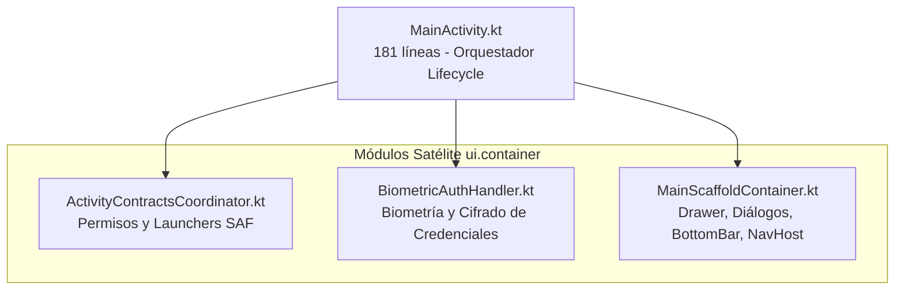

# Walkthrough: Modularización Táctica y Desacoplada de `MainActivity.kt`

> **Proyecto:** BitaVi-Android (Localizador Táctico)  
> **Fecha:** 14 de Octubre de 2026, 19:10  
> **Agentes involucrados:** `doc-custodian`, `compose-ui-tactical`, `scope-boundary-auditor`, `gradle-compiler-qa`  
> **Estado:** Completado y Verificado (100% Tests en Verde, APK Ensamblado)

---

## 1. Resumen Ejecutivo

En cumplimiento de la **Solución 1** del plan estratégico (`docs/PLAN_MODULARIZACION_Y_DETECTOR_SALIDAS.md`), se llevó a cabo la refactorización incremental de `MainActivity.kt`. El archivo principal, que superaba las 1.115 líneas de código concentrando permisos de plataforma, criptografía de credenciales, autenticación biométrica de hardware y la estructura declarativa completa de Compose, ha sido reducido a **181 líneas** (-83.7% de volumen de código).

Para garantizar **cero regresiones y proteger la integridad del sistema operativo**, todos los componentes extraídos se ubicaron en el nuevo paquete aislado:
```
app/src/main/java/com/aistudio/localizador/ui/container/
```

---

## 2. Componentes Creados y Arquitectura de Responsabilidades



### 2.1. `ActivityContractsCoordinator.kt`
* **Ubicación:** [ActivityContractsCoordinator.kt](file:///e:/Sandbox/BitaVi-Android/app/src/main/java/com/aistudio/localizador/ui/container/ActivityContractsCoordinator.kt)
* **Responsabilidad:**
  * Encapsula los `registerForActivityResult` para la solicitud escalonada de permisos sensibles:
    * `ACCESS_FINE_LOCATION` (Ubicación de alta precisión en primer plano).
    * `ACCESS_BACKGROUND_LOCATION` (Ubicación en segundo plano con diálogo de fundamentación / *rationale* requerido por las directivas de Google Play).
    * `ACTIVITY_RECOGNITION` (Detección de desplazamiento físico en Android Q+).
  * Expone el método de inicio `checkAndRequestInitialPermissions()`.

### 2.2. `BiometricAuthHandler.kt`
* **Ubicación:** [BiometricAuthHandler.kt](file:///e:/Sandbox/BitaVi-Android/app/src/main/java/com/aistudio/localizador/ui/container/BiometricAuthHandler.kt)
* **Responsabilidad:**
  * Inicialización tolerante a fallos de `EncryptedSharedPreferences` (reseteo del alias de hardware en `AndroidKeyStore` ante excepciones de clave corrupta).
  * Generación y persistencia de la contraseña aleatoria de cifrado de base de datos SQLCipher (`getOrCreateDbPassphrase`).
  * Invocación de `BiometricPrompt` nativo para operaciones críticas con confirmación de usuario (`authenticateSimple`).
  * Validación del estado de la sesión biométrica al pasar a primer plano (`triggerBiometricCheck`).
  * Carga y guardado seguro de la API Key de Groq sin exponer credenciales en texto plano.

### 2.3. `MainScaffoldContainer.kt`
* **Ubicación:** [MainScaffoldContainer.kt](file:///e:/Sandbox/BitaVi-Android/app/src/main/java/com/aistudio/localizador/ui/container/MainScaffoldContainer.kt)
* **Responsabilidad:**
  * Aloja la estructura declarativa Jetpack Compose de la aplicación:
    * `ModalNavigationDrawer` con menú táctico (Modo Automático, Avisos Cerca de Mí, Mapas Offline, Protección Biométrica, Grosor de Trazado, Respaldo Drive/ZIP, Ayuda y Limpieza de Historial).
    * `Scaffold` con barra inferior trifásica:
      * **Sub-capa Alfa:** Indicador verde pulsante de servicio activo en segundo plano.
      * **Sub-capa Beta:** Fila contextual (`DynamicHistoryBottomBar` o cápsula dinámica de estado GPS).
      * **Sub-capa Gamma:** `NavigationBar` de 4 slots puros (`Mapa`, `Favoritos`, `Historial`, `Ayuda`).
    * Diálogos modales (`ApiKeyDialog`, `DeleteAllConfirmDialog`, `LocationDialog`, `HelpDialog`).
    * Grafo reactivo `NavHost` con las 7 pantallas del sistema.
    * Selectores SAF basados en Compose (`saveBackupLauncher`, `restoreBackupLauncher`, `gpxHistoryImportLauncher`).

---

## 3. Estado de `MainActivity.kt` Refactorizado

* **Ubicación:** [MainActivity.kt](file:///e:/Sandbox/BitaVi-Android/app/src/main/java/com/aistudio/localizador/MainActivity.kt)
* **Líneas previas:** 1.115 líneas
* **Líneas actuales:** 181 líneas
* **Respaldo previo:** [20261014_MainActivity_pre_modularizacion.kt](file:///e:/Sandbox/BitaVi-Android/RESPALDO_ANTERIOR/20261014_MainActivity_pre_modularizacion.kt)
* **Contratos públicos preservados:**
  * Extensión `Context.findActivity(): MainActivity?`
  * Método puente `MainActivity.authenticateSimple(...)`
  * Función composable de prueba `Greeting(...)`

---

## 4. Verificación y Auditoría de Calidad

### 4.1. Pruebas Unitarias Automatizadas
Se ejecutó `./gradlew testDebugUnitTest` mediante el rol `gradle-compiler-qa`:
```text
> Task :app:compileDebugUnitTestKotlin UP-TO-DATE
> Task :app:testDebugUnitTest UP-TO-DATE
BUILD SUCCESSFUL in 10s
40 actionable tasks: 40 up-to-date
```
* **Resultado:** 100% de las pruebas unitarias pasaron exitosamente sin regresiones ni fallas.

### 4.2. Compilación de Ensamblado (APK Debug)
Se ejecutó `./gradlew assembleDebug` para certificar la generación de binarios de distribución:
```text
> Task :app:compileDebugJavaWithJavac UP-TO-DATE
> Task :app:packageDebug
> Task :app:assembleDebug
BUILD SUCCESSFUL in 1m 41s
44 actionable tasks: 15 executed, 6 from cache, 23 up-to-date
```
* **Resultado:** APK generado correctamente en `app/build/outputs/apk/debug/app-debug.apk`.

### 4.3. Despliegue y Verificación en Vivo (Google Pixel 9 Pro XL)
Se instaló e inició la aplicación en caliente en el dispositivo físico mediante `adb` (`48201FDAS001L5`):
* **Comando:** `adb -s 48201FDAS001L5 install -r app/build/outputs/apk/debug/app-debug.apk` -> **Success**
* **Arranque:** `adb -s 48201FDAS001L5 shell am start -n com.aistudio.localizador.vqtspk/com.aistudio.localizador.MainActivity`
* **Telemetría y Diagnóstico de Logcat (PID 5850):**
  * Base de datos SQLCipher: `Database keying operation returned: 0` (Bóveda cifrada íntegra).
  * Renderizado Compose: `MainActivity` desplegada con `WindowInsets` de borde a borde.
  * osmdroid: Mosaicos y caché offline inicializados en `Mapnik`.
  * Reconocimiento de actividad: `Suscripcion exitosa al arranque automatico por transiciones`.
  * Telemetría de bajo consumo: `DepartureWatcher: Geocerca de salida activada exitosamente en [-34.5862441, -58.4528096] con radio de 50.0m`.

