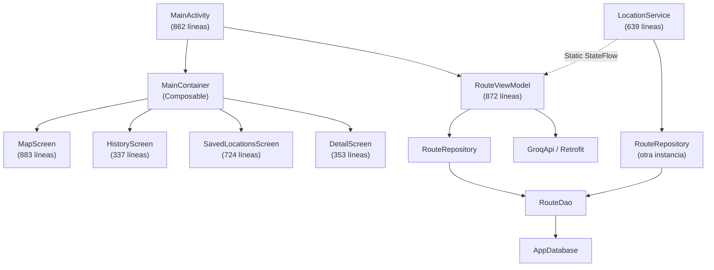
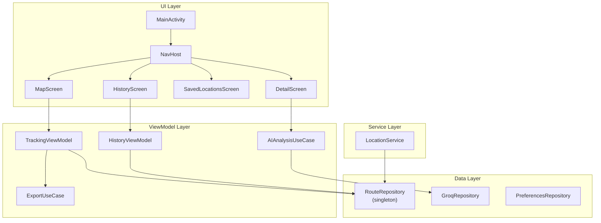

# 🔬 Auditoría Estática Completa — Localizador Pro (Android)

> **Fecha:** 2026-06-21  
> **Auditor:** Ingeniero Principal de Control de Calidad y Rendimiento Android  
> **Alcance:** 20 archivos fuente Kotlin, manifiestos, Gradle, recursos  
> **Modo:** Solo lectura — ningún archivo fue modificado  

---

## Índice

- [Resumen Ejecutivo](#resumen-ejecutivo)
- [Hallazgos de Severidad ALTA](#-severidad-alta-17-hallazgos)
- [Hallazgos de Severidad MEDIA](#-severidad-media-21-hallazgos)
- [Hallazgos de Severidad BAJA](#-severidad-baja-12-hallazgos)
- [Análisis de Rendimiento](#-análisis-de-rendimiento)
- [Análisis de Seguridad](#-análisis-de-seguridad)
- [Análisis de Arquitectura](#-análisis-de-arquitectura)
- [Observaciones Adicionales](#-observaciones-adicionales)

---

## Resumen Ejecutivo

| Categoría          | Alta | Media | Baja | Total |
|--------------------|:----:|:-----:|:----:|:-----:|
| Bugs Potenciales   |  6   |   5   |  2   |  13   |
| Rendimiento        |  5   |   7   |  3   |  15   |
| Arquitectura       |  3   |   5   |  3   |  11   |
| Seguridad          |  2   |   2   |  1   |   5   |
| Material / UX      |  1   |   2   |  3   |   6   |
| **Total**          | **17** | **21** | **12** | **50** |

El proyecto es funcional y demuestra un buen nivel de integración de funcionalidades (GPS, Room, biometría, OSMDroid, Retrofit). Sin embargo, la concentración de lógica en pocos archivos masivos, la ausencia de inyección de dependencias, y varios patrones de manejo incorrecto de contextos y corrutinas generan riesgos concretos de fugas de memoria, ANRs, y pérdida de datos.

---

## 🔴 Severidad ALTA (17 hallazgos)

### A01 — ViewModel con acceso directo a `Context` (Memory Leak)

> [!CAUTION]
> Riesgo de fuga de memoria por retención de Activity/Context

- **Archivos:** [RouteViewModel.kt](file:///home/delm/Documentos/Google%20IA%20Studio/localizador/app/src/main/java/com/example/ui/RouteViewModel.kt) — múltiples funciones
- **Detalle:** El ViewModel recibe `Context` como parámetro en **21 funciones** (`toggleAutoMode`, `toggleNearMe`, `toggleBiometric`, `saveSpecificLocation`, `fetchCurrentAddress`, `exportRoutesAsCSV`, `exportRoutesAsGPX`, `importGpxFile`, `createImageFile`, `saveImageToInternalStorage`, `prepareBackupFile`, `restoreFromBackup`, `getContactDetails`, `shareLocation`, `shareCompleteRoute`, `fetchAddressForCoordinates`, `fetchAddressForLocation`, `generateSuggestedRouteName`, `getPhotoLocation`, `refreshLocationDetails`, `updateDefaultLocationPersistently`).
- **Impacto:** Si se pasa el Activity Context, la Activity no podrá ser recolectada por el GC mientras el ViewModel viva (que sobrevive a recreaciones de Activity). Esto es un **memory leak clásico de Android**.
- **Sugerencia:** Usar `AndroidViewModel` con `Application` context, o inyectar un `SharedPreferences` wrapper y un `ContentResolver` en el constructor del ViewModel en lugar de pasar Context.

---

### A02 — `LocationService` crea instancia propia de `RouteRepository` (Estado inconsistente)

> [!CAUTION]
> Dos instancias de Repository/DAO coexisten sin coordinación

- **Archivo:** [LocationService.kt:101-102](file:///home/delm/Documentos/Google%20IA%20Studio/localizador/app/src/main/java/com/example/location/LocationService.kt#L101-L102)
- **Detalle:** El Service instancia `AppDatabase.getDatabase()` y crea su propio `RouteRepository`. Aunque `AppDatabase` es un singleton, tener dos instancias de `RouteRepository` sin inyección de dependencias puede causar inconsistencias si en el futuro el Repository adquiere estado interno (caché, buffers).
- **Sugerencia:** Implementar un contenedor de DI (Hilt/Koin/manual) para compartir una única instancia de Repository.

---

### A03 — `CoroutineScope` del Service sin manejo de excepciones global

> [!WARNING]
> Excepciones no capturadas en `serviceScope` terminan silenciosamente las corrutinas

- **Archivo:** [LocationService.kt:31](file:///home/delm/Documentos/Google%20IA%20Studio/localizador/app/src/main/java/com/example/location/LocationService.kt#L31)
- **Detalle:** `CoroutineScope(Dispatchers.IO + SupervisorJob())` — Aunque `SupervisorJob` evita la cancelación en cascada, no hay `CoroutineExceptionHandler`. Las excepciones en corrutinas hijas (como DB writes en `processNewLocation`) se pierden silenciosamente.
- **Impacto:** Puntos GPS pueden dejar de guardarse sin ningún indicador visible.
- **Sugerencia:** Agregar un `CoroutineExceptionHandler` que al menos registre el error con `Log.e`.

---

### A04 — Callback de ubicación ejecuta en `Looper.getMainLooper()` (UI Thread)

> [!CAUTION]
> Procesamiento GPS en el hilo principal

- **Archivo:** [LocationService.kt:235](file:///home/delm/Documentos/Google%20IA%20Studio/localizador/app/src/main/java/com/example/location/LocationService.kt#L235)
- **Detalle:** `fusedLocationClient.requestLocationUpdates(locationRequest, locationCallback, Looper.getMainLooper())` — El callback `onLocationResult` ejecuta en el Main Thread. Dentro de él, `processNewLocation()` lee `SharedPreferences` síncronamente (L248-250) y accede a estado mutable.
- **Impacto:** Con intervalos de 1 segundo y lógica compleja, esto bloquea el UI thread cada tick. Aunque el lanzamiento de la corrutina es en IO, toda la lógica de filtrado y decisiones previa (L244-325) corre en Main.
- **Sugerencia:** Usar un `HandlerThread` dedicado o un `Looper` secundario para el callback de ubicación.

---

### A05 — `SharedPreferences` leídas en cada tick de ubicación

> [!WARNING]
> Lectura síncrona repetitiva en cada actualización GPS

- **Archivos:** [LocationService.kt:248-250](file:///home/delm/Documentos/Google%20IA%20Studio/localizador/app/src/main/java/com/example/location/LocationService.kt#L248-L250) y [LocationService.kt:462-463](file:///home/delm/Documentos/Google%20IA%20Studio/localizador/app/src/main/java/com/example/location/LocationService.kt#L462-L463)
- **Detalle:** `PreferenceManager.getDefaultSharedPreferences(applicationContext)` se llama en `processNewLocation()` (cada 1-5 seg) y en `startTimer()` (cada 5 seg). Cada llamada resuelve el path del archivo, potencialmente ejecutando I/O.
- **Sugerencia:** Cachear la referencia a `SharedPreferences` como propiedad del Service, y usar un `OnSharedPreferenceChangeListener` para invalidar valores cacheados.

---

### A06 — `fallbackToDestructiveMigration()` — Pérdida de datos en producción

> [!CAUTION]
> Los usuarios perderán TODOS sus datos si se cambia el esquema de la base de datos

- **Archivo:** [AppDatabase.kt:35](file:///home/delm/Documentos/Google%20IA%20Studio/localizador/app/src/main/java/com/example/data/db/AppDatabase.kt#L35)
- **Detalle:** `fallbackToDestructiveMigration()` destruye y recrea la base de datos completa cuando la versión cambia sin migraciones definidas. Ya están en la versión 7 — cada una de estas transiciones pudo haber borrado datos de usuario.
- **Sugerencia:** Implementar `Migration` objects para transiciones de esquema, o al mínimo usar `fallbackToDestructiveMigrationOnDowngrade()` y definir migraciones para upgrades.

---

### A07 — `isMinifyEnabled = false` en Release (Sin ofuscación ni optimización)

> [!WARNING]
> APK de release sin protección ni optimización de código

- **Archivo:** [app/build.gradle.kts:46](file:///home/delm/Documentos/Google%20IA%20Studio/localizador/app/build.gradle.kts#L46)
- **Detalle:** `isMinifyEnabled = false` desactiva R8/ProGuard. El código Kotlin es decompilable trivialmente, exponiendo la lógica de cifrado, endpoints de API, y estructura interna.
- **Impacto:** Sin shrinking, el APK incluye todas las clases de Moshi, Retrofit, OkHttp, Material Icons Extended (miles de iconos innecesarios), resultando en un APK significativamente más grande.
- **Sugerencia:** Activar `isMinifyEnabled = true` con reglas ProGuard adecuadas para Room, Moshi, Retrofit.

---

### A08 — Proguard Rules vacías (no protegen Room, Moshi, Retrofit)

> [!WARNING]
> Si se activa R8, la app crasheará sin reglas keep

- **Archivo:** [proguard-rules.pro](file:///home/delm/Documentos/Google%20IA%20Studio/localizador/app/proguard-rules.pro)
- **Detalle:** El archivo está prácticamente vacío (solo comentarios de plantilla). Faltan reglas `@Keep` para:
  - Entidades Room (`Route`, `LocationPoint`, `Waypoint`, `SavedLocation`)
  - Clases Moshi con `@JsonClass(generateAdapter = true)` (`GroqRequest`, `GroqResponse`, etc.)
  - Interfaces Retrofit (`GroqApi`)
- **Sugerencia:** Agregar reglas keep para las data classes y interfaces de serialización/red.

---

### A09 — Bloque `catch` vacío en operaciones críticas (Errores silenciosos)

> [!WARNING]
> Múltiples operaciones de I/O fallan silenciosamente

- **Archivos y líneas:**
  - [RouteViewModel.kt:229](file:///home/delm/Documentos/Google%20IA%20Studio/localizador/app/src/main/java/com/example/ui/RouteViewModel.kt#L229) — `fetchCurrentAddress`: `catch (e: Exception) { }`
  - [RouteViewModel.kt:381](file:///home/delm/Documentos/Google%20IA%20Studio/localizador/app/src/main/java/com/example/ui/RouteViewModel.kt#L381) — `saveCsvFile`: `catch (e: Exception) { }`
  - [RouteViewModel.kt:407](file:///home/delm/Documentos/Google%20IA%20Studio/localizador/app/src/main/java/com/example/ui/RouteViewModel.kt#L407) — `saveGpxFile`: `catch (e: Exception) { }`
  - [RouteViewModel.kt:436](file:///home/delm/Documentos/Google%20IA%20Studio/localizador/app/src/main/java/com/example/ui/RouteViewModel.kt#L436) — `importGpxFile`: `catch (e: Exception) { }`
  - [LocationService.kt:413](file:///home/delm/Documentos/Google%20IA%20Studio/localizador/app/src/main/java/com/example/location/LocationService.kt#L413) — `checkProximityToFavorites`: `catch (e: Exception) { }`
  - [MapScreen.kt:339](file:///home/delm/Documentos/Google%20IA%20Studio/localizador/app/src/main/java/com/example/ui/screens/MapScreen.kt#L339) — Map `update` block: `catch (e: Exception) { }`
- **Impacto:** Los usuarios no reciben feedback cuando la exportación CSV/GPX falla, cuando la importación se corrompe, o cuando las notificaciones de proximidad fallan.
- **Sugerencia:** Al mínimo, registrar logs (`Log.e`) y mostrar un Toast al usuario en las operaciones de exportación/importación.

---

### A10 — `Retrofit` instanciado en cada llamada a la IA

> [!WARNING]
> Creación redundante de OkHttpClient y Retrofit por cada análisis

- **Archivo:** [RouteViewModel.kt:335-341](file:///home/delm/Documentos/Google%20IA%20Studio/localizador/app/src/main/java/com/example/ui/RouteViewModel.kt#L335-L341)
- **Detalle:** `OkHttpClient.Builder()...build()` y `Retrofit.Builder()...build()` se ejecutan cada vez que el usuario solicita un análisis con IA. Cada instancia de OkHttpClient crea su propio pool de conexiones y threads.
- **Impacto:** Fuga de threads y sockets, consumo de memoria innecesario.
- **Sugerencia:** Crear una instancia `lazy` singleton de `Retrofit` (idealmente inyectada), reutilizada entre llamadas.

---

### A11 — Actualización masiva de overlays del mapa en cada recomposición

> [!CAUTION]
> Rendimiento de UI degradado por recreación constante de objetos gráficos

- **Archivo:** [MapScreen.kt:263-339](file:///home/delm/Documentos/Google%20IA%20Studio/localizador/app/src/main/java/com/example/ui/screens/MapScreen.kt#L263-L339)
- **Detalle:** El bloque `update` de `AndroidView` ejecuta en cada recomposición (triggered por `routePoints`, `waypoints`, `savedLocations`, `isTracking`, `latestLocation`). En cada ejecución:
  1. Elimina TODOS los overlays `Polyline` y `Marker` (L288)
  2. Recrea la Polyline con sort (L290-297)
  3. Recrea TODOS los markers de waypoints (L298-316)
  4. Recrea TODOS los markers de favoritos (L319-337)
  5. Crea nuevos Drawables y los convierte a Bitmap (L274-286)
- **Impacto:** Con 100+ favoritos y rutas largas, esto genera miles de objetos por segundo, causando jank visible y presión de GC.
- **Sugerencia:** Implementar diffing — solo actualizar overlays que cambiaron. Cachear los Bitmaps de los drawables.

---

### A12 — `MapView` instanciada con `remember` sin `DisposableEffect` completo

> [!WARNING]
> MapView no se destruye correctamente en `DetailScreen`

- **Archivo:** [DetailScreen.kt:60](file:///home/delm/Documentos/Google%20IA%20Studio/localizador/app/src/main/java/com/example/ui/screens/DetailScreen.kt#L60)
- **Detalle:** `val mapView = remember { MapView(context) }` — En `DetailScreen`, el MapView se crea con `remember` pero no hay `DisposableEffect` que invoque `mapView.onDetach()` o `mapView.onPause()/onResume()`. Comparar con `MapScreen.kt:151-153` que sí tiene el `DisposableEffect`.
- **Impacto:** Fuga del MapView y de su tile cache cuando el usuario navega fuera del detalle.
- **Sugerencia:** Agregar un `DisposableEffect` equivalente al de `MapScreen`.

---

### A13 — Cast inseguro `context as MainActivity` en Composable

> [!WARNING]
> Crash garantizado si el Composable se usa fuera de la Activity actual

- **Archivo:** [MainActivity.kt:227](file:///home/delm/Documentos/Google%20IA%20Studio/localizador/app/src/main/java/com/example/MainActivity.kt#L227)
- **Detalle:** `val mainActivity = context as MainActivity` — Este cast lanza `ClassCastException` si el composable se ejecuta en un contexto diferente (preview, test, multi-window). También impide la reutilización del composable.
- **Sugerencia:** Obtener la Activity con `LocalContext.current.findActivity()` (extensión) o pasar las funciones necesarias como lambdas.

---

### A14 — `deleteRoutes` ejecuta deletes secuenciales sin transacción

> [!WARNING]
> Borrado masivo lento y potencialmente parcial

- **Archivo:** [RouteViewModel.kt:214](file:///home/delm/Documentos/Google%20IA%20Studio/localizador/app/src/main/java/com/example/ui/RouteViewModel.kt#L214)
- **Detalle:** `routeIds.forEach { repository.deleteRoute(it) }` — Cada delete es una operación DB individual. Si ocurre un error a mitad, se borran parcialmente las rutas.
- **Sugerencia:** Crear una operación `@Transaction` en el DAO que acepte una lista de IDs: `@Query("DELETE FROM routes WHERE id IN (:ids)")`.

---

### A15 — `EncryptedSharedPreferences` instanciado en cada recomposición

> [!WARNING]
> Inicialización costosa en `remember` sin garantía de estabilidad

- **Archivo:** [MainActivity.kt:200-211](file:///home/delm/Documentos/Google%20IA%20Studio/localizador/app/src/main/java/com/example/MainActivity.kt#L200-L211)
- **Detalle:** `EncryptedSharedPreferences.create()` dentro de un `remember {}` en un Composable. Esta operación implica acceso al AndroidKeyStore (operación criptográfica costosa). Aunque `remember` cachea el resultado, se re-ejecuta si la composición se recrea.
- **Sugerencia:** Mover la creación de `EncryptedSharedPreferences` al `onCreate()` de la Activity y pasarlo como parámetro o usar un wrapper inyectado.

---

### A16 — `exportSchema = false` en Room Database

> [!WARNING]
> Imposible generar migraciones automáticas sin esquema exportado

- **Archivo:** [AppDatabase.kt:18](file:///home/delm/Documentos/Google%20IA%20Studio/localizador/app/src/main/java/com/example/data/db/AppDatabase.kt#L18)
- **Detalle:** Sin exportar el esquema, no se pueden crear migraciones automáticas ni verificar la integridad del esquema en tests.
- **Sugerencia:** Habilitar `exportSchema = true` y configurar el directorio de esquemas en `build.gradle.kts`.

---

### A17 — `org.gradle.parallel` definido dos veces con valores contradictorios

> [!WARNING]
> Configuración de Gradle inconsistente

- **Archivo:** [gradle.properties:11 y :16](file:///home/delm/Documentos/Google%20IA%20Studio/localizador/gradle.properties#L11-L16)
- **Detalle:** 
  - Línea 11: `org.gradle.parallel=false`
  - Línea 16: `org.gradle.parallel=true`
  
  La última definición gana (`true`), pero tener la anterior como `false` con el comentario "Ajuste para máquina de 4GB de RAM" indica intención conflictiva.
- **Sugerencia:** Eliminar una de las dos líneas para claridad.

---

## 🟡 Severidad MEDIA (21 hallazgos)

### M01 — `MainActivity` de 862 líneas (God Activity)

- **Archivo:** [MainActivity.kt](file:///home/delm/Documentos/Google%20IA%20Studio/localizador/app/src/main/java/com/example/MainActivity.kt)
- **Detalle:** Contiene la Activity, el contenedor de navegación, 5 diálogos modales, la barra de navegación, la configuración de osmdroid, la lógica biométrica, y el drawer completo. Excede ampliamente el principio de responsabilidad única.
- **Sugerencia:** Extraer: (a) NavHost/Navigator en un archivo separado, (b) cada diálogo en un `@Composable` independiente, (c) la configuración de OSMDroid en un helper.

---

### M02 — `RouteViewModel` de 872 líneas (God ViewModel)

- **Archivo:** [RouteViewModel.kt](file:///home/delm/Documentos/Google%20IA%20Studio/localizador/app/src/main/java/com/example/ui/RouteViewModel.kt)
- **Detalle:** Combina lógica de: navegación, tracking GPS, exportación CSV/GPX, importación GPX, respaldo ZIP, análisis IA, gestión de contactos, manejo de fotos, geocoding, y serialización. Más de 50 funciones públicas.
- **Sugerencia:** Dividir en: `TrackingViewModel`, `ExportViewModel`, `BackupViewModel`, `AIAnalysisViewModel` o usar UseCases separados.

---

### M03 — Navegación manual con `mutableStateOf` en lugar de Navigation Component

- **Archivo:** [RouteViewModel.kt:48-53](file:///home/delm/Documentos/Google%20IA%20Studio/localizador/app/src/main/java/com/example/ui/RouteViewModel.kt#L48-L53) y [RouteViewModel.kt:66](file:///home/delm/Documentos/Google%20IA%20Studio/localizador/app/src/main/java/com/example/ui/RouteViewModel.kt#L66)
- **Detalle:** La navegación se implementa con `var currentScreen by mutableStateOf<Screen>(Screen.Tracking)`. Aunque `navigation-compose` está en las dependencias (L94 de build.gradle.kts), no se usa. No hay soporte para deep links, back stack, ni animaciones de transición.
- **Sugerencia:** Migrar a `NavHost` con `composable()` routes para obtener soporte de back button, deep links, y state restoration.

---

### M04 — Composables no usan `Modifier` de forma idiomática

- **Archivos:** [MapScreen.kt:345](file:///home/delm/Documentos/Google%20IA%20Studio/localizador/app/src/main/java/com/example/ui/screens/MapScreen.kt#L345), [MapScreen.kt:437](file:///home/delm/Documentos/Google%20IA%20Studio/localizador/app/src/main/java/com/example/ui/screens/MapScreen.kt#L437)
- **Detalle:** Múltiples Composables encadenan `.padding()` y `.align()` directamente sin pasar el `Modifier` parameter, lo que dificulta la reutilización.

---

### M05 — `Toast.makeText` llamado desde background thread (potencial crash)

- **Archivos:**
  - [RouteViewModel.kt:539](file:///home/delm/Documentos/Google%20IA%20Studio/localizador/app/src/main/java/com/example/ui/RouteViewModel.kt#L539): `Toast.makeText(context, ...)` dentro de `launch(Dispatchers.IO)` — envuelto en `withContext(Dispatchers.Main)` ✅
  - [MainActivity.kt:288](file:///home/delm/Documentos/Google%20IA%20Studio/localizador/app/src/main/java/com/example/MainActivity.kt#L288): `Toast.makeText(context, "Restaurando datos y fotos...", ...)` — ejecutado en el callback de `onResult` del ActivityResultLauncher, que podría no estar en Main ⚠️
- **Detalle:** La mayoría están correctamente envueltos en `withContext(Dispatchers.Main)`, pero algunos en callbacks podrían ejecutarse fuera del hilo principal dependiendo del ciclo de vida.

---

### M06 — `UserAgentValue` falsifica un navegador Chrome

- **Archivo:** [MainActivity.kt:117](file:///home/delm/Documentos/Google%20IA%20Studio/localizador/app/src/main/java/com/example/MainActivity.kt#L117)
- **Detalle:** `Configuration.getInstance().userAgentValue = "Mozilla/5.0 (Windows NT 10.0; Win64; x64)..."` — Falsificar el User-Agent de un navegador de escritorio para descargar tiles de OpenStreetMap viola los [términos de uso de OSM](https://operations.osmfoundation.org/policies/tiles/).
- **Sugerencia:** Usar un User-Agent descriptivo: `"LocalizadorPro/1.0 Android"`.

---

### M07 — Formato de respaldo/restauración frágil basado en `|` delimiters

- **Archivos:** [RouteViewModel.kt:468-473](file:///home/delm/Documentos/Google%20IA%20Studio/localizador/app/src/main/java/com/example/ui/RouteViewModel.kt#L468-L473) (backup), [RouteViewModel.kt:568-604](file:///home/delm/Documentos/Google%20IA%20Studio/localizador/app/src/main/java/com/example/ui/RouteViewModel.kt#L568-L604) (restore)
- **Detalle:** Los datos se serializan como texto separado por `|`. Si algún campo (nombre, dirección, comentario) contiene el carácter `|`, el parsing se corrompe silenciosamente. No hay header ni versión del formato.
- **Sugerencia:** Usar JSON o CSV con escape apropiado. Agregar un campo de versión para compatibilidad futura.

---

### M08 — Restauración de backup escribe directamente archivos de base de datos

- **Archivo:** [RouteViewModel.kt:563-565](file:///home/delm/Documentos/Google%20IA%20Studio/localizador/app/src/main/java/com/example/ui/RouteViewModel.kt#L563-L565)
- **Detalle:** `if (name.contains("localizador_database"))` — Copia archivos de base de datos directamente al filesystem mientras Room puede tener la DB abierta. Esto puede corromper la base de datos y causar crashes de SQLite.
- **Sugerencia:** Cerrar la instancia de Room antes de sobrescribir archivos de DB, o usar Room's backup/restore API.

---

### M09 — `OnConflictStrategy.REPLACE` en todas las inserciones del DAO

- **Archivo:** [RouteDao.kt:14,44,47,59,70](file:///home/delm/Documentos/Google%20IA%20Studio/localizador/app/src/main/java/com/example/data/db/RouteDao.kt#L14)
- **Detalle:** Todos los `@Insert` usan `OnConflictStrategy.REPLACE`. Esto significa que si se inserta un registro con el mismo `id`, reemplaza silenciosamente los datos existentes en lugar de fallar.
- **Impacto:** Puede causar pérdida silenciosa de datos si se duplican IDs (por ejemplo, durante la restauración de backup).
- **Sugerencia:** Usar `OnConflictStrategy.ABORT` (default) para operaciones donde los duplicados indican un bug, y `IGNORE` para importación.

---

### M10 — `deleteAllData()` no borra puntos de ubicación ni waypoints ni fotos

- **Archivo:** [RouteRepository.kt:202-205](file:///home/delm/Documentos/Google%20IA%20Studio/localizador/app/src/main/java/com/example/data/repository/RouteRepository.kt#L202-L205)
- **Detalle:** Solo borra `routes` y `saved_locations`. Los `location_points` y `waypoints` se borran por CASCADE de la FK. Sin embargo, las fotos físicas en `filesDir/images` NO se borran.
- **Impacto:** El almacenamiento del dispositivo se llena con fotos huérfanas.
- **Sugerencia:** Agregar limpieza de `File(context.filesDir, "images")` en la operación de limpieza.

---

### M11 — `material-icons-extended` importado completo

- **Archivo:** [app/build.gradle.kts:84](file:///home/delm/Documentos/Google%20IA%20Studio/localizador/app/build.gradle.kts#L84)
- **Detalle:** `implementation(libs.androidx.compose.material.icons.extended)` incluye **miles** de iconos de Material. Sin R8/ProGuard activado, todos se incluyen en el APK.
- **Impacto:** Aumenta el tamaño del APK en ~5-10 MB innecesariamente.
- **Sugerencia:** Si R8 está desactivado, importar solo los iconos necesarios con `additive` o activar R8 para tree-shaking.

---

### M12 — `namespace = "com.example"` — Namespace genérico

- **Archivo:** [app/build.gradle.kts:14](file:///home/delm/Documentos/Google%20IA%20Studio/localizador/app/build.gradle.kts#L14)
- **Detalle:** El namespace es `com.example` (genérico de template), mientras que el `applicationId` es `com.aistudio.localizador.vqtspk`. Esta discrepancia puede causar confusiones en imports, R class, y conflictos con otros proyectos de ejemplo.
- **Sugerencia:** Alinear el namespace al applicationId o a un dominio controlado.

---

### M13 — `firebase-bom` incluido pero sin productos Firebase utilizados

- **Archivo:** [app/build.gradle.kts:76](file:///home/delm/Documentos/Google%20IA%20Studio/localizador/app/build.gradle.kts#L76)
- **Detalle:** `implementation(platform(libs.firebase.bom))` está presente, pero no hay ninguna librería Firebase individual como dependencia. Esto agrega resolución de dependencias innecesaria.
- **Sugerencia:** Eliminar `firebase-bom` si no se usa ningún producto Firebase.

---

### M14 — `exifinterface` y `mpandroidchart` declarados inline (no en catálogo)

- **Archivo:** [app/build.gradle.kts:116-119](file:///home/delm/Documentos/Google%20IA%20Studio/localizador/app/build.gradle.kts#L116-L119)
- **Detalle:** Dos dependencias usan declaración inline en lugar del catálogo de versiones (`libs.versions.toml`). `mpandroidchart:v3.1.0` proviene de JitPack y es una librería antigua (2020) sin mantenimiento activo.
- **Sugerencia:** Migrar al catálogo de versiones. Evaluar alternativas modernas a MPAndroidChart como `Vico` o charts en Compose Canvas puro (ya hay un `ElevationChart` implementado pero sin usar).

---

### M15 — Composable `ElevationChart` definido pero no utilizado

- **Archivo:** [DetailScreen.kt:317-336](file:///home/delm/Documentos/Google%20IA%20Studio/localizador/app/src/main/java/com/example/ui/screens/DetailScreen.kt#L317-L336)
- **Detalle:** El composable `ElevationChart` basado en Canvas puro está implementado pero no se referencia en ninguna parte (se usa `ProfessionalChart` en su lugar).
- **Sugerencia:** Eliminar el código muerto o usarlo como alternativa para dispositivos sin la librería MPAndroidChart.

---

### M16 — `Geocoder` llamado en el hilo IO sin verificar disponibilidad

- **Archivos:** [RouteViewModel.kt:226-228](file:///home/delm/Documentos/Google%20IA%20Studio/localizador/app/src/main/java/com/example/ui/RouteViewModel.kt#L226-L228), [RouteViewModel.kt:283](file:///home/delm/Documentos/Google%20IA%20Studio/localizador/app/src/main/java/com/example/ui/RouteViewModel.kt#L283)
- **Detalle:** `Geocoder(context, Locale.getDefault())` puede no estar disponible en dispositivos sin Google Play Services. `Geocoder.isPresent()` nunca se verifica.
- **Sugerencia:** Verificar `Geocoder.isPresent()` antes de usar, y proporcionar un fallback (por ejemplo, coordenadas formateadas).

---

### M17 — `startService()` usado para detener tracking en lugar de `stopService()`

- **Archivo:** [RouteViewModel.kt:200-201](file:///home/delm/Documentos/Google%20IA%20Studio/localizador/app/src/main/java/com/example/ui/RouteViewModel.kt#L200-L201)
- **Detalle:** Se envía una Intent con `ACTION_STOP` via `context.startService()`. Aunque funciona, es semánticamente confuso y reinicia el Service si ya estaba detenido.
- **Sugerencia:** Patrón correcto, pero documentar que el servicio se auto-detiene con `stopSelf()` internamente.

---

### M18 — `preStartBuffer` es una `mutableListOf` no thread-safe

- **Archivo:** [LocationService.kt:50](file:///home/delm/Documentos/Google%20IA%20Studio/localizador/app/src/main/java/com/example/location/LocationService.kt#L50)
- **Detalle:** `private val preStartBuffer = mutableListOf<LocationPoint>()` — Accedido desde el callback de ubicación (Main thread) y leído/limpiado desde `startAutoNewRoute` (corrutina IO). No hay sincronización.
- **Impacto:** `ConcurrentModificationException` potencial.
- **Sugerencia:** Usar `Collections.synchronizedList()` o `CopyOnWriteArrayList`.

---

### M19 — Hardcoded strings en español por todo el código

- **Archivos:** Todos los archivos de UI
- **Detalle:** Todos los textos de UI están hardcodeados en español directamente en el código Kotlin: `"Autenticación Requerida"`, `"Localizador"`, `"Grabar"`, etc. No usan `stringResource(R.string.xxx)`.
- **Impacto:** Imposible internacionalizar. Dificulta el testing automatizado.
- **Sugerencia:** Extraer todos los strings a `res/values/strings.xml`.

---

### M20 — `derivedStateOf` con `System.currentTimeMillis()` nunca se recomputa automáticamente

- **Archivo:** [MapScreen.kt:78-80](file:///home/delm/Documentos/Google%20IA%20Studio/localizador/app/src/main/java/com/example/ui/screens/MapScreen.kt#L78-L80)
- **Detalle:** `val isManualMode by remember { derivedStateOf { System.currentTimeMillis() - lastInteractionTime < 10000L } }` — `derivedStateOf` solo se recomputa cuando sus entradas de estado cambian (`lastInteractionTime`). Pero el valor de `System.currentTimeMillis()` NO es un estado observable, por lo que la comparación temporal no funciona como se espera (no se actualiza automáticamente cada segundo).
- **Impacto:** `isManualMode` puede quedar en `true` indefinidamente hasta que otro evento de estado lo invalide.
- **Sugerencia:** En la práctica, el `LaunchedEffect(lastInteractionTime)` en L191-196 maneja el timeout reseteando `lastInteractionTime`, lo que indirectamente recomputa `isManualMode`. Sin embargo, `isManualMode` no se usa directamente — se usa `lastInteractionTime != 0L` en su lugar (L159, L267). Este `derivedStateOf` es código muerto efectivo.

---

### M21 — `tileDownloadThreads = 5` innecesariamente alto para mapas

- **Archivo:** [MainActivity.kt:126](file:///home/delm/Documentos/Google%20IA%20Studio/localizador/app/src/main/java/com/example/MainActivity.kt#L126)
- **Detalle:** Cinco threads de descarga de tiles compiten con el procesamiento GPS y la UI por recursos en un dispositivo de 4 GB RAM.
- **Sugerencia:** Reducir a 2-3 threads, especialmente para dispositivos de gama baja.

---

## 🟢 Severidad BAJA (12 hallazgos)

### B01 — `Greeting` composable sin uso funcional

- **Archivo:** [MainActivity.kt:858-861](file:///home/delm/Documentos/Google%20IA%20Studio/localizador/app/src/main/java/com/example/MainActivity.kt#L858-L861)
- **Detalle:** Template residual de proyecto nuevo. Ocupa espacio y puede confundir.

### B02 — Scripts `.sh` de ADB en el directorio `app/`

- **Archivos:** `app/new.sh`, `app/new2.sh`, `app/new3.sh`, `app/new4.sh`
- **Detalle:** Scripts de reinicio de ADB no deberían estar en el directorio del módulo. Contienen rutas hardcodeadas.

### B03 — `.env` contiene placeholders en texto plano

- **Archivo:** [.env](file:///home/delm/Documentos/Google%20IA%20Studio/localizador/.env)
- **Detalle:** `GEMINI_API_KEY=MY_GEMINI_API_KEY` — No es un secreto real, pero la presencia del archivo en el repositorio puede confundir.

### B04 — `DarkColorScheme` no personalizado

- **Archivo:** [Theme.kt:14-19](file:///home/delm/Documentos/Google%20IA%20Studio/localizador/app/src/main/java/com/example/ui/theme/Theme.kt#L14-L19)
- **Detalle:** Los colores dark siguen siendo los defaults de Material (`Purple80`, `PurpleGrey80`) mientras que los colores light están completamente personalizados. La experiencia dark mode será visualmente inconsistente.

### B05 — Colores hardcodeados en Composables

- **Archivos:** [MapScreen.kt:294,349](file:///home/delm/Documentos/Google%20IA%20Studio/localizador/app/src/main/java/com/example/ui/screens/MapScreen.kt#L294), [MainActivity.kt:720](file:///home/delm/Documentos/Google%20IA%20Studio/localizador/app/src/main/java/com/example/MainActivity.kt#L720)
- **Detalle:** `Color(0xFF1B5E20)`, `Color(0xFF21005D)`, `Color(0xFF25D366)` — Colores usados directamente en lugar de referirse al theme del Material Design.
- **Sugerencia:** Definir colores semánticos en el ColorScheme del Theme.

### B06 — `isCrunchPngs = false` desactiva optimización de PNGs

- **Archivo:** [app/build.gradle.kts:45](file:///home/delm/Documentos/Google%20IA%20Studio/localizador/app/build.gradle.kts#L45)
- **Detalle:** Desactiva la compresión de PNGs en release builds, aumentando el tamaño del APK.

### B07 — Duplicación del color picker en 4 pantallas

- **Archivos:** MapScreen (waypoint dialog + save location dialog), SavedLocationsScreen (add dialog + edit dialog)
- **Detalle:** El componente de selección de color (slider + chips predefinidos) se repite idénticamente en 4 lugares. ~40 líneas por instancia.
- **Sugerencia:** Extraer un `@Composable ColorPicker(selectedColor, onColorSelected)`.

### B08 — Duplicación del bloque de cámara/galería en 3 pantallas

- **Archivos:** MapScreen (2 veces), SavedLocationsScreen (1 vez)
- **Detalle:** Los botones de "Cámara" y "Galería" con su lógica de permisos se repiten en 3 lugares.
- **Sugerencia:** Extraer un `@Composable PhotoCapture(onPhotoSelected)`.

### B09 — `Typography` solo define `bodyLarge`

- **Archivo:** [Type.kt](file:///home/delm/Documentos/Google%20IA%20Studio/localizador/app/src/main/java/com/example/ui/theme/Type.kt)
- **Detalle:** Solo se personaliza `bodyLarge`. El resto de estilos tipográficos usan defaults, pero se aplican extensivamente por todo el código.

### B10 — `tileFileSystemCacheMaxBytes = 500MB` excesivo

- **Archivo:** [MainActivity.kt:129](file:///home/delm/Documentos/Google%20IA%20Studio/localizador/app/src/main/java/com/example/MainActivity.kt#L129)
- **Detalle:** 500 MB de caché de tiles es considerable para un dispositivo móvil, especialmente de gama baja.

### B11 — `SavedLocation` usa `import` FQN en DAO

- **Archivo:** [RouteDao.kt:71,74,77,80](file:///home/delm/Documentos/Google%20IA%20Studio/localizador/app/src/main/java/com/example/data/db/RouteDao.kt#L71)
- **Detalle:** `com.example.data.model.SavedLocation` se referencia con nombre completo en lugar de un import.

### B12 — `biometric` y `security-crypto` usan versiones alpha

- **Archivo:** [libs.versions.toml:43-44](file:///home/delm/Documentos/Google%20IA%20Studio/localizador/gradle/libs.versions.toml#L43-L44)
- **Detalle:** `biometric = "1.2.0-alpha05"` y `securityCrypto = "1.1.0-alpha06"`. Versiones alpha pueden tener bugs y APIs inestables.

---

## ⚡ Análisis de Rendimiento

### Hilo Principal (UI Thread)

| Problema | Ubicación | Impacto |
|----------|-----------|---------|
| Callback GPS en Main Looper | LocationService L235 | Bloqueo periódico del UI cada 1-5s |
| SharedPreferences leídas en cada tick GPS | LocationService L248 | I/O síncrona en Main thread |
| Conversión de Drawables a Bitmaps en `update` | MapScreen L274-286 | Allocations en cada recomposición |
| Eliminación y recreación de todos los overlays | MapScreen L288 | O(n) por cada frame en rutas largas |
| `sortedBy` en cada update de overlay | MapScreen L292 | Ordenamiento O(n log n) repetido |

### Fugas de Memoria (Memory Leaks)

| Patrón | Riesgo | Archivos |
|--------|--------|----------|
| ViewModel retiene Activity Context | **ALTO** | RouteViewModel (21 funciones) |
| MapView sin DisposableEffect | **MEDIO** | DetailScreen L60 |
| OkHttpClient creado por llamada | **MEDIO** | RouteViewModel L335 |
| Static MutableStateFlow en companion | **BAJO** | LocationService L83-96 (intencionalmente estático, no leak real) |
| `preStartBuffer` crece durante 30 min | **BAJO** | LocationService L51 |

### Consumo de Batería y Red

| Factor | Evaluación |
|--------|-----------|
| Intervalo GPS mínimo | 1 seg (configurable) — puede ser agresivo para batería |
| `PRIORITY_HIGH_ACCURACY` siempre | No hay adaptación según velocidad o contexto |
| 5 threads de descarga de tiles | Alto para dispositivos limitados |
| Caché de 500 MB en disco | Uso excesivo de almacenamiento |
| `tileDownloadThreads = 5` | Compite con GPS y UI por recursos |
| Retrofit sin connection pooling | Conexiones TCP innecesarias a Groq |

### Recomendaciones de Rendimiento Prioritarias

1. **Mover el callback GPS a un thread secundario** para liberar el Main thread
2. **Cachear SharedPreferences** en el Service como propiedad de instancia
3. **Implementar diffing en overlays del mapa** — solo actualizar lo que cambió
4. **Singleton de Retrofit/OkHttp** para la API de Groq
5. **Agregar `DisposableEffect` al MapView** de DetailScreen

---

## 🔒 Análisis de Seguridad

### Puntos Fuertes ✅

- **Cifrado AES/GCM con Android Keystore** para la API Key de Groq
- **Biometría con `CryptoObject`** — verdadera autenticación vinculada a hardware
- **`setInvalidatedByBiometricEnrollment(true)`** — protección ante cambios de huellas
- **`EncryptedSharedPreferences`** para almacenamiento sensible
- **`FileProvider`** para compartir archivos entre apps

### Vulnerabilidades Detectadas ⚠️

| ID | Vulnerabilidad | Severidad |
|----|---------------|-----------|
| S01 | `isMinifyEnabled = false` expone código decompilable | ALTA |
| S02 | API Key de Groq pasada como string en memoria (`groqApiKey`) | MEDIA |
| S03 | `android:allowBackup="true"` permite extracción de datos via ADB | MEDIA |
| S04 | Sin certificate pinning para la API de Groq | BAJA |
| S05 | User-Agent falsificado puede violar ToS de tile providers | BAJA |

### Nota sobre S02

La API key de Groq se descifra y almacena en `var groqApiKey by mutableStateOf<String?>` — permanece en memoria como texto plano durante toda la sesión. Aunque el almacenamiento es seguro (EncryptedSharedPreferences + Keystore), un dump de memoria del proceso podría extraerla.

---

## 🏗️ Análisis de Arquitectura

### Diagrama de Dependencias Actual

### Problemas Arquitectónicos

1. **Ausencia de Inyección de Dependencias**: Todo se instancia manualmente en `onCreate()`. El Service crea su propia instancia de Repository. No hay inversión de control.

2. **Acoplamiento ViewModel ↔ View**: El ViewModel conoce `Context`, `Intent`, `Uri`, `Bitmap`, `SharedPreferences`, y `Toast`. Debería ser agnóstico a Android.

3. **Comunicación Service ↔ UI via Static StateFlow**: Funciona, pero es un patrón frágil. Si el Service es destruido y recreado, los StateFlows se reinician. Considerar `ServiceConnection` con `Binder` o un `BroadcastReceiver`.

4. **Single-module monolítico**: Todo el código vive en `:app`. Para un proyecto de este tamaño es aceptable, pero dificulta la escalabilidad.

5. **Navigation sin NavHost**: Se pierde soporte de back stack, deep links, state restoration, y animaciones. El `when` block en L803-830 es un reemplazo manual frágil.

### Arquitectura Recomendada

---

## 📋 Observaciones Adicionales

### Archivos en el directorio raíz del proyecto

El proyecto contiene múltiples archivos de documentación, prompts, y respaldos en el directorio raíz que no pertenecen a un proyecto Android estándar:

| Archivo | Observación |
|---------|-------------|
| `PROMPT_CORRECCION.txt` | Prompt de IA — no debería estar en el repo |
| `Prompt Localizador.txt` | Prompt de IA — no debería estar en el repo |
| `RESPALDO_CHAT.md` | Conversación con IA — no debería estar en el repo |
| `RESPALDO_ANTERIOR/` | Backup manual — debería usar Git branches |
| `skill.md`, `skill-anterior.md` | Instrucciones de IA — no debería estar en el repo |
| `instrucciones_agente.md` | Instrucciones de IA — no debería estar en el repo |
| `localizador.zip` | ZIP del propio proyecto dentro del proyecto |

**Sugerencia:** Agregar estos archivos al `.gitignore` y eliminarlos del tracking de Git.

### Puntos Positivos del Código

1. **Buen uso de `StateFlow`** para comunicar estado reactivo entre el Service y la UI
2. **Filtros de GPS sólidos** — drift detection, sanity checks de velocidad, modo avión
3. **Patrón Repository** implementado correctamente con separación DAO/Repository
4. **Foreign Keys con CASCADE** en Room — limpieza automática de datos huérfanos
5. **Buffer de pre-grabación** — solución creativa para capturar movimiento antes del inicio
6. **Cifrado biométrico real** con CryptoObject — no es solo "gating" de UI
7. **Diseño de UI Material 3** bien aplicado con color scheme personalizado

---

> **Fin del Reporte.** Todos los hallazgos son sugerencias documentales. Ningún archivo del workspace fue modificado.
